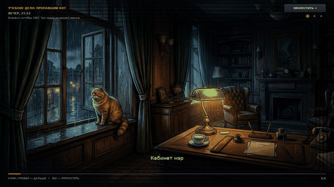
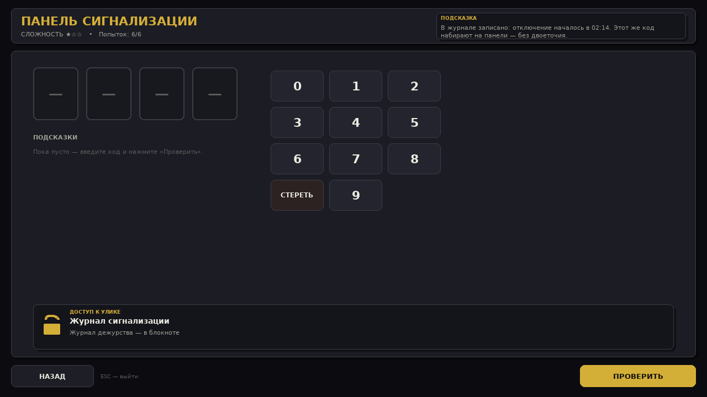
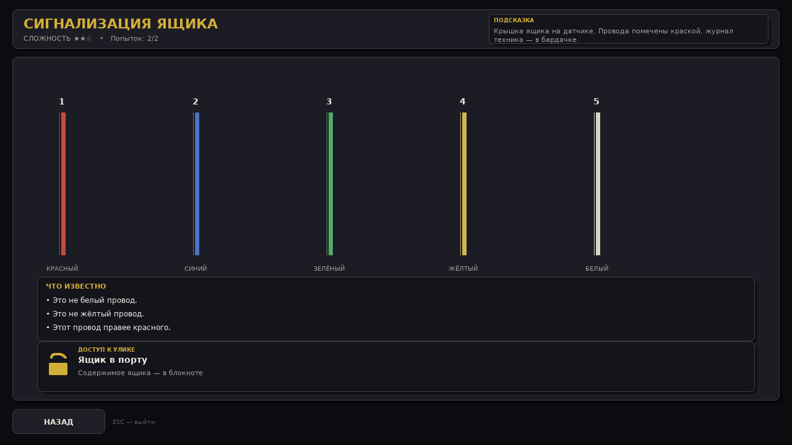
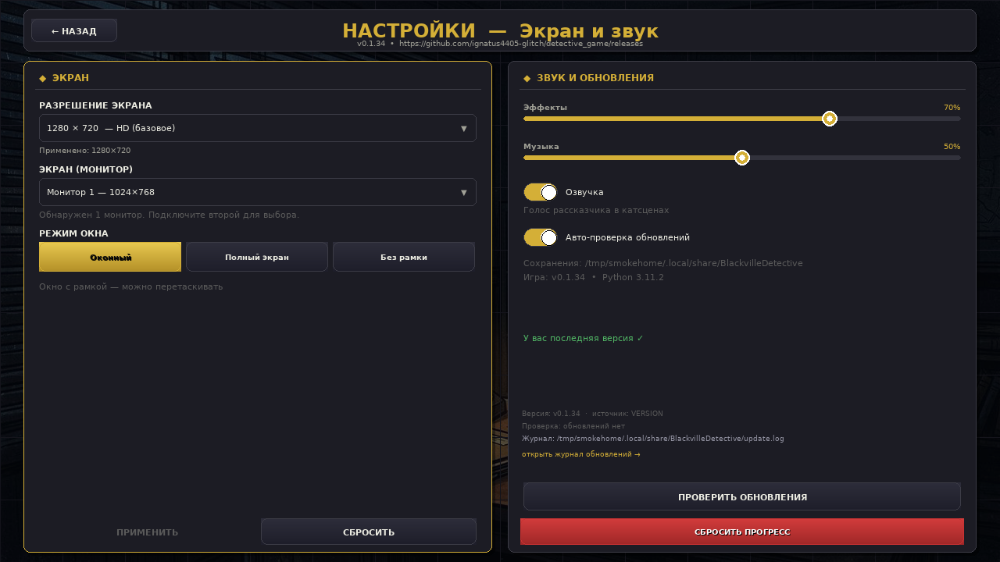
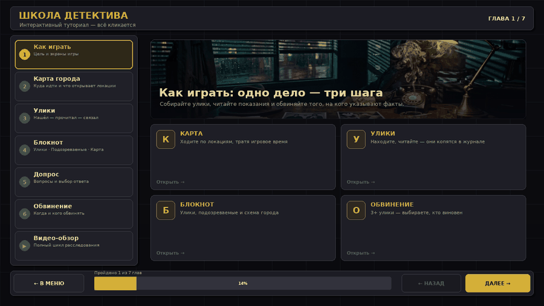

# ДЕТЕКТИВ: БЛЭКВИЛ — Код Города

> **Нуар-расследование в стиле KodGoroda.games — теперь на Windows.**

Вы не смотрите детектив. Вы — его главный герой. Погрузитесь в атмосферу вымышленного американского городка Блэквил 80-х, исследуйте более 10 локаций, допрашивайте свидетелей, собирайте улики и выберите, кого обвинить. Каждое решение — шаг к правде или в пропасть.


---

## 🎮 Геймплей — как в [KodGoroda.games](https://kodgoroda.games/#game)

| Механика KodGoroda | Реализация в игре |
|---|---|
| **Интерактивная карта 1000+ локаций** | Стилизованная карта Блэквила с районами (Центр, Порт, Север, Холмы). Локации открываются по цепочке улик — как в оригинале |
| **Поиск улик** | 10 улик на дело; часть заперта за головоломками — кодовый замок, отмычки, провода, последовательность |
| **Допросы** | Диалоговые ветки с бонусами от бэкграунда детектива |
| **Блокнот/Досье** | Журнал улик, подозреваемые, хронология |
| **Финальное обвинение** | Выбор виновного → уникальные концовки с рангом S/A/B/C/D |
| **Командная игра 1–6 чел.** | Hot-seat / стрим-режим — обсуждайте версии за одним ПК (сетевая игра — в roadmap) |

### Дела в релизе

1. **Загадочное похищение** (★★☆, 60–90 мин) — исчезновение 9-летнего шахматиста Артёма. Труп фотографа, плёнка, серый плащ.
2. **Тень ячейки №314** (★★★, 45–70 мин) — ограбление банка за 10 минут тишины. Три подозреваемых, у всех был код.

---

## 🎬 Вступление к каждому делу

Дело начинается с **видео-катсцены**: три кадра о том, что случилось до вас —
завязка, преступление, утро после. Медленный наезд камеры, печатающиеся
субтитры, таймлайн кадров.

- **Клик / пробел** — допечатать подпись, второй клик — следующий кадр;
- **Esc** или **«ПРОПУСТИТЬ →»** — сразу к карте;
- пересмотреть можно с карты: **«▶ КАК ВСЁ БЫЛО»** в журнале.



## 🧩 Головоломки и мини-игры

Три улики в каждом деле не лежат на виду: их охраняет замок. На локации такая
улика подписана кнопкой **«ВЗЛОМАТЬ»** — открывается мини-игра, и только
победа отдаёт улику.

| Тип | Механика | Пример в игре |
| --- | --- | --- |
| **Кодовый замок** | 4 цифры + подсказки «больше/меньше» по каждой | панель сигнализации банка |
| **Отмычки** | попасть бегунком в зелёную зону трижды | ячейка №314, стол завхоза ДК |
| **Провода** | найти единственный провод по набору условий | датчик на ящике в порту |
| **Последовательность** | запомнить и повторить порядок фигур | проявка плёнки Ланского |

Провал не блокирует расследование: попытка стоит 15 минут игрового времени,
замок можно открыть позже. Победа даёт улику, её `leads_to` и +10 минут.




## 🎵 Музыка, эффекты и озвучка

- **5 музыкальных тем**, синтезированных кодом (нуар, расследование,
  напряжение, победа, провал) — без внешних файлов и интернета; кэш в папке
  сохранений `music/*.wav`.
- **Эффекты**: клики, страницы блокнота, найденная улика, щелчки отмычки,
  провал, набор кода.
- **Озвучка катсцен** — голос рассказчика (ogg, ~600 КБ на три дела). Текст
  совпадает с субтитрами; если файла нет — титры остаются. Кадр держится, пока
  звучит голос.
- **Настройки → «ЗВУК И ОБНОВЛЕНИЯ»**: ползунки музыки и эффектов применяются
  на лету, переключатель «Озвучка» отключает голос, оставляя субтитры.



## 🎓 Туториал — «Школа детектива»

Не знаете, с чего начать? В меню есть кнопка **ТУТОРИАЛ** (или **F1**):
интерактивный экран, где всё кликается.

- **Карта** — тыкаете по пинам, видите, что открывает каждая локация;
- **Улики** — карточки с картинками: важность ★/☆ и куда улика ведёт;
- **Блокнот** — три вкладки: улики, подозреваемые, карта;
- **Допрос** — реплики-кнопки и ответы персонажа;
- **Обвинение** — выбор подозреваемого и оба исхода;
- **Видео-обзор** — анимированный проход по игре с плеером, таймлайном и паузой.

Гайд с картинками и гифкой: **[docs/TUTORIAL.md](docs/TUTORIAL.md)**



## 🕵️ Кастомизация детектива

При первом запуске:

- **Имя** — вводится в текстовом поле, используется в диалогах
- **Аватар** — 6 образов (Рейн, Мара, Коул, Вивиан, Шедоу, Лора) — цветовые аватары в нуар-стиле
- **Прошлое** — влияет на диалоги:
  - `Частный сыщик` — улица доверяет
  - `Бывший коп` — видит детали в полицейских протоколах
  - `Репортёр` — разговорит бармена и свидетелей

Все сохраняется в `%APPDATA%/BlackvilleDetective/detective.json` и переживает переустановку.

---

## 🚀 Быстрый старт

### Windows (готовая сборка)

1. Скачайте `Detective-Blackville-vX.Y.Z-Windows.zip` из [Releases](https://github.com/ignatus4405-glitch/detective_game/releases)
2. Распакуйте → запустите `DetectiveBlackville.exe`
3. При первом запуске создайте детектива → выберите дело

### Из исходников (любая ОС)

```bash
git clone https://github.com/ignatus4405-glitch/detective_game.git
cd detective_game
pip install -r requirements.txt
# или pip install -e .[dev]

# Запуск
python -m detective_game
# или
detective-game
# или напрямую через launcher (исправляет ошибку установщика):
python launcher.py
```

**Требования:** Python 3.10+, pygame 2.5+, Windows 10/11 (сборка), Linux/macOS — для разработки.

### 🔧 Исправление ошибки установщика (v0.1.3)

**Было:** `Failed to execute script 'main' — attempted relative import with no known parent package` (см. скриншот) — PyInstaller собирал `src/detective_game/main.py` напрямую, у него `__package__ == None` → `from .config import *` падал.

**Исправлено:** точка входа теперь `launcher.py` в корне (absolute import `from detective_game.main import main`) + `--paths src --collect-all detective_game` в `tools/build.ps1` и `.github/workflows/*.yml`. Проверьте `dist/README.txt` после сборки.

### 🛡️ SmartScreen / Защитник Windows

Неподписанный `.exe` без репутации вызывает *«Система Windows защитила ваш компьютер»* — это не вирус, а политика Microsoft.

**Что делать:**
1. Правый клик по `DetectiveBlackville.exe` → Свойства → **Разблокировать** (внизу) → ОК
2. Запуск → **Подробнее** → **Выполнить в любом случае**
3. Или используйте установщик `DetectiveBlackville-Setup.exe` (Inno Setup) — у него больше доверия

**Что мы сделали чтобы снизить срабатывания:**
- Метаданные VERSION (`--version-file` → CompanyName/ProdVersion)
- Манифест `asInvoker` (`--manifest` → не просит админских прав)
- Иконка + SHA256 хеш в релизе для проверки `Get-FileHash`

Подробно: [`docs/SMARTSCREEN.md`](docs/SMARTSCREEN.md) | Хеш: `certUtil -hashfile DetectiveBlackville.exe SHA256`

---

## 🔄 Автообновление

Игра сама проверяет GitHub Releases при старте:

```python
GET https://api.github.com/repos/ignatus4405-glitch/detective_game/releases/latest
```

- Если `latest.tag_name > VERSION` — зелёный баннер: **⬇ Скачать → ▶ Установить**
- С 0.1.28 игра обновляет себя **архивом, без инсталлятора**: скачивает `DetectiveBlackville-Windows.zip`, сверяет SHA256, распаковывает во временную папку и после выхода игры копирует файлы в **ту же папку, откуда она запущена** — без окна консоли. Потом запускается сама.
- Если папка защищена (Program Files) — Windows один раз попросит подтверждение (UAC), обновится установщиком
- Ошибки сети больше не маскируются под «последняя версия»: видно причину
- После перезапуска игра пишет «Обновление установлено — теперь vX.Y.Z», а при сбое — красный баннер с кнопками «ЖУРНАЛ» и «СКАЧАТЬ ВРУЧНУЮ»
- Ручная проверка — **Настройки → Проверить обновления**, авто-проверку можно выключить там же

Версия хранится в файле `VERSION` в корне репо и попадает в exe при сборке (CI + `tools/generate_version_info.py`). CI проверяет синхронизацию с `pyproject.toml` и создаёт релиз при пуше тега `v*`.

### Если обновление не встало

- Обновляетесь с версии **0.1.23 или старше** и запускали игру из распакованного zip? Запустите скачанный `DetectiveBlackville-Setup-0.1.24.exe` вручную и укажите **ту же папку**, где лежит ваш exe — дальше автообновление работает «в свою» папку.
- Обновление не встало, игра открылась в прежней версии? Откройте журнал `%APPDATA%\BlackvilleDetective\update.log` (кнопка «ЖУРНАЛ» в баннере) — там код возврата `xcopy`, версия файлов после копирования и причина сбоя.
- Настройки → блок обновлений: если написано «Не удалось проверить», это сеть/лимит GitHub, а не «последняя версия».

Подробнее: [docs/UPDATE_SYSTEM.md](docs/UPDATE_SYSTEM.md)

---

## 🛠️ Сборка

### Локально в exe (Windows)

```bash
pip install pyinstaller
python tools/generate_version_info.py   # вшивает BUILD_VERSION в пакет
pyinstaller --name DetectiveBlackville --onedir --windowed \
  --paths src --collect-all detective_game \
  --add-data "VERSION;." --add-data "VERSION;detective_game" \
  launcher.py
# exe появится в dist/DetectiveBlackville/
```

> `--add-data "VERSION;."` обязателен: без него собранная игра не найдёт версию
> и будет считать себя `0.1.0` (вечный баннер обновления). CI это проверяет шагом
> «Verify VERSION is bundled».

Скрипт: `tools/build.ps1` / `tools/build.sh` (см. [docs/BUILD.md](docs/BUILD.md))

### CI — GitHub Actions

Каждый пуш запускает:

1. **Lint & Test** (`ci.yml`) — ruff + pytest на ubuntu/windows
2. **Build** (`build.yml`) — сборка exe на `windows-latest`, загрузка артефакта
3. **Release** (`release.yml`) — при пуше тега `v*` → создание Release с `DetectiveBlackville-Windows.zip` + `latest.json`

Бейджи сборки отражают статус последнего workflow.

Подробнее: [docs/CI_CD.md](docs/CI_CD.md)

---

## 📁 Структура проекта

```
detective_game/
├── VERSION                # текущая версия (semver)
├── pyproject.toml         # зависимости и метаданные
├── src/detective_game/
│   ├── main.py            # главный цикл и все экраны
│   ├── config.py          # константы, цвета, пути
│   ├── game_state.py      # DetectiveProfile, GameState, AVATARS
│   ├── save_system.py     # сохранения в %APPDATA%/BlackvilleDetective
│   ├── updater.py         # проверка GitHub Releases
│   ├── synth.py           # синтез музыки и эффектов (чистый stdlib)
│   ├── audio.py           # движок звука: темы по экранам, sfx, озвучка
│   ├── puzzles.py         # головоломки: замок, отмычки, провода, порядок
│   ├── data.py            # загрузка кейсов (JSON)
│   ├── assets/            # изображения, звуки, шрифты
│   ├── cases/             # JSON-описания дел (расширяемо)
│   └── ui/widgets.py      # кнопки, панели, аватарки
│       ui/puzzle_view.py  # экран головоломки: отрисовка и ввод
├── tests/                 # pytest
├── docs/                  # документация для агентов
├── tools/                 # скрипты сборки, генерации ассетов
└── .github/workflows/     # CI/CD
```

Расширение игры — добавить новый `cases/case_id.json` и он появится в выборе дел (см. [docs/CASE_FORMAT.md](docs/CASE_FORMAT.md)).

---

## 🤖 Для AI-агентов

> Этот репозиторий документирован так, чтобы любой агент мог продолжить работу без контекста.

Обязательно прочитайте:

1. **[docs/AGENT_GUIDE.md](docs/AGENT_GUIDE.md)** — чек-лист для продолжения, где что лежит, как запускать автосборку
2. **[docs/ARCHITECTURE.md](docs/ARCHITECTURE.md)** — архитектура экранов и стейт-машины
3. **[docs/CHANGELOG.md](docs/CHANGELOG.md)** — история изменений (ведётся вручную + ботом)
4. **[CHANGELOG.md](CHANGELOG.md)** — релизный чейнджлог (генерируется из коммитов)

После **каждого изменения** запускайте:

```bash
pytest -q
python -m detective_game --smoke-test  # если реализовано
```

и пушьте — CI сам соберёт exe. См. [CONTRIBUTING.md](CONTRIBUTING.md).

---

## 📜 Лицензия

MIT — см. [LICENSE](LICENSE). Ассеты-заглушки — CC0. Образ Блэквила вдохновлён KodGoroda.games, но все тексты и сюжеты оригинальны.

---

## 🙏 Благодарности

- [KodGoroda.games](https://kodgoroda.games) — за идею живой карты и атмосферы нуара 80-х
- Pygame community
- Всем детективам, кто тестировал ранние билды

> *«Город не спит. Он ждёт, когда ты ошибёшься.»* — надпись на столе детектива Рейна

