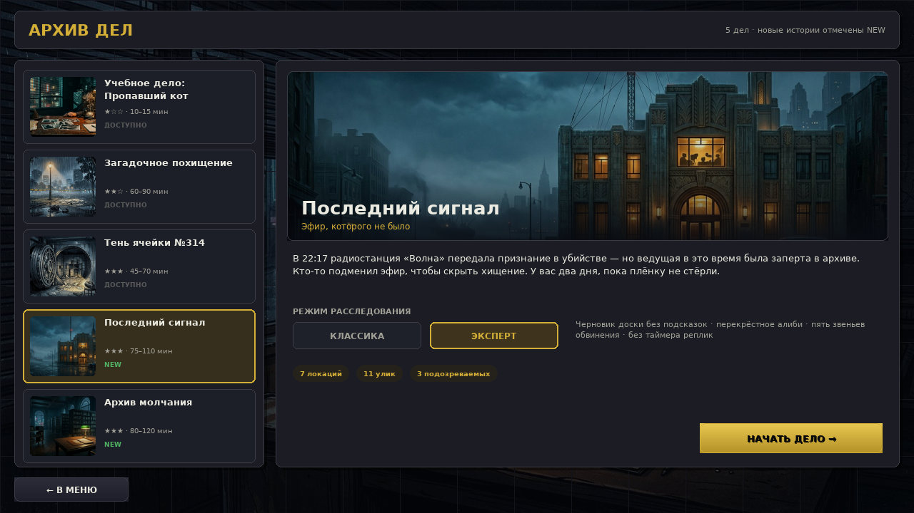
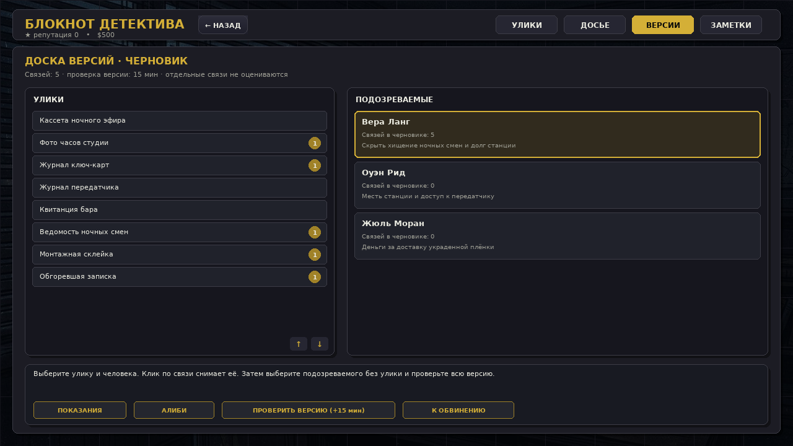
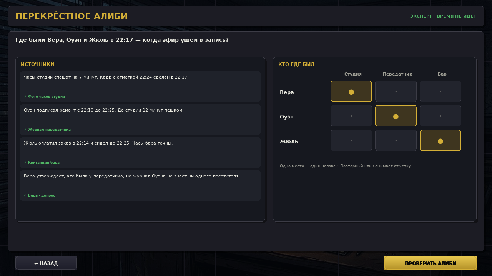
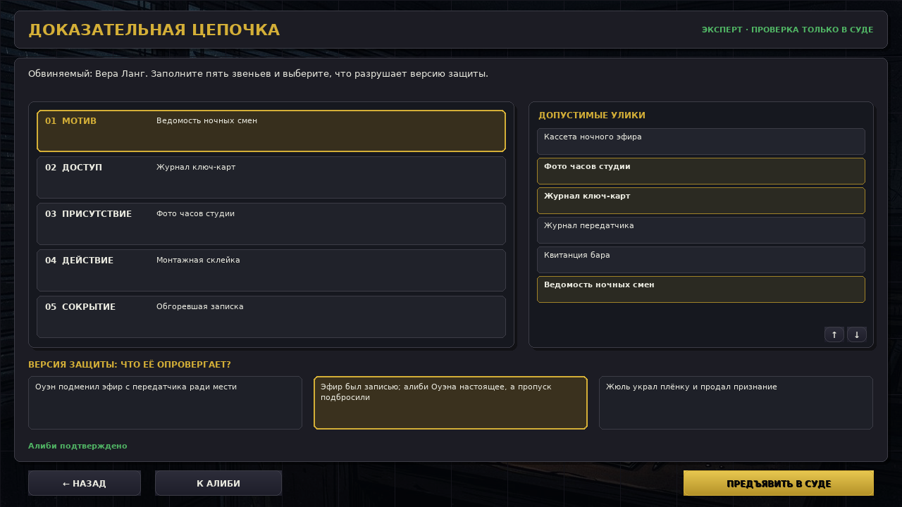
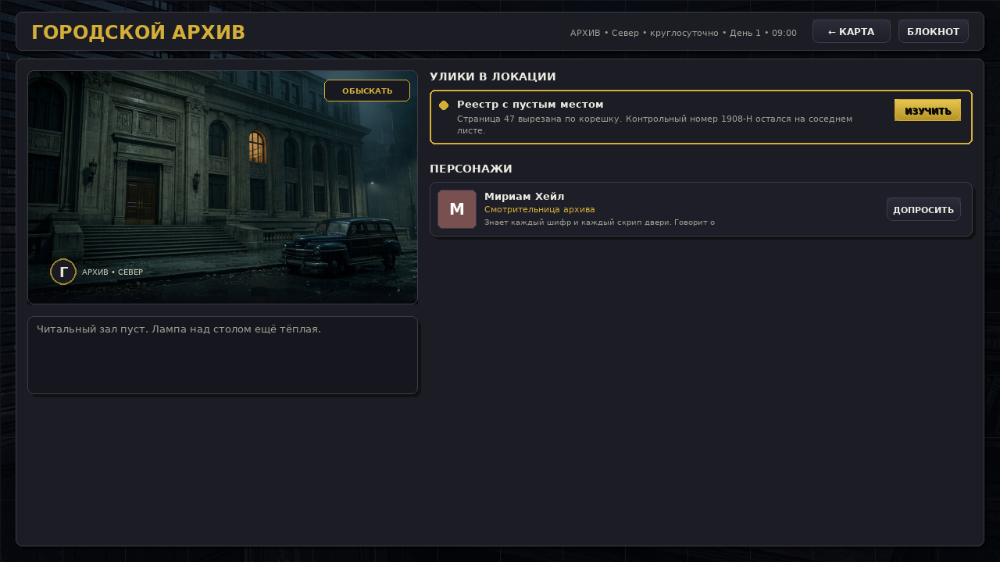
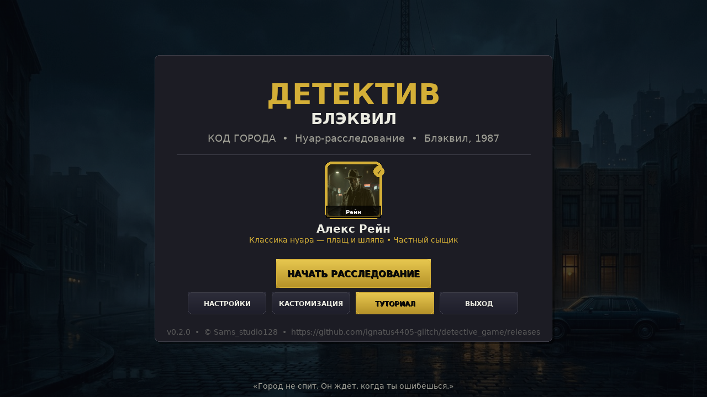

# Режим «Эксперт» — думать, а не кликать быстрее

> Версия 0.2.0 · Для больших дел: «Загадочное похищение», «Тень ячейки №314», «Последний сигнал», «Архив молчания».

Обычный режим остаётся прежним. Перед стартом большого дела на экране **«Архив дел»** можно выбрать **«ЭКСПЕРТ»**.

## Что меняется

| Было | Стало в «Эксперте» |
| --- | --- |
| Доска сразу говорила «верно/неверно» | Доска — черновик гипотез. Отдельные связи не оцениваются. |
| Алиби было отдельной мини-игрой | Появилось **перекрёстное алиби**: часы, журналы, время в пути и показания. |
| Обвинение по имени, мотиву и способу | Нужна **доказательная цепочка**: мотив → доступ → присутствие → действие → сокрытие. |
| Защита могла быть проигнорирована | Нужно выбрать, что **опровергает альтернативную версию**. |
| Таймер реплики и обыска подгонял | В «Эксперте» чтение, доска, алиби и цепочка идут **без таймера**. Обыск без патруля и обратного отсчёта. |

## Доска версий

Выберите улику слева и подозреваемого справа — связь попадёт в черновик. Повторный клик снимает её. Клик по подозреваемому **без выбранной улики** выбирает, чью версию проверять.

Кнопка **«ПРОВЕРИТЬ ВЕРСИЮ»** стоит 15 игровых минут и проверяет версию целиком. Игра не подсвечивает отдельные связи, а говорит, каких звеньев не хватает и есть ли лишние.

## Перекрёстное алиби

Слева — источники. Они открываются только после находки или реально услышанной реплики. Справа — сетка «кто где был». Одно место занимает один человек.

Нужно учитывать поправки часов и время в пути. Проверка стоит 10 минут при ошибке и не подсказывает, какая клетка неверна.

## Доказательная цепочка

На экране обвинения выберите подозреваемого, мотив и способ, затем нажмите **«СОБРАТЬ ЦЕПОЧКУ»**.

Заполните пять звеньев допустимыми уликами и выберите опровержение версии защиты. Суд проверяет всё целиком. Если цепочка рвётся — дело не раскрыто, даже если имя угадано.

## Новые дела

### Последний сигнал
Радиостанция «Волна» передаёт признание, которого никто не произносил. Кассета, часы студии, журнал передатчика и ведомость ночных смен.

### Архив молчания
Из земельного реестра исчезает страница до суда. Пожар должен был скрыть пропажу, но уцелел контрольный номер. Ключи, водяные знаки и переплётный пресс.

## Главное меню

